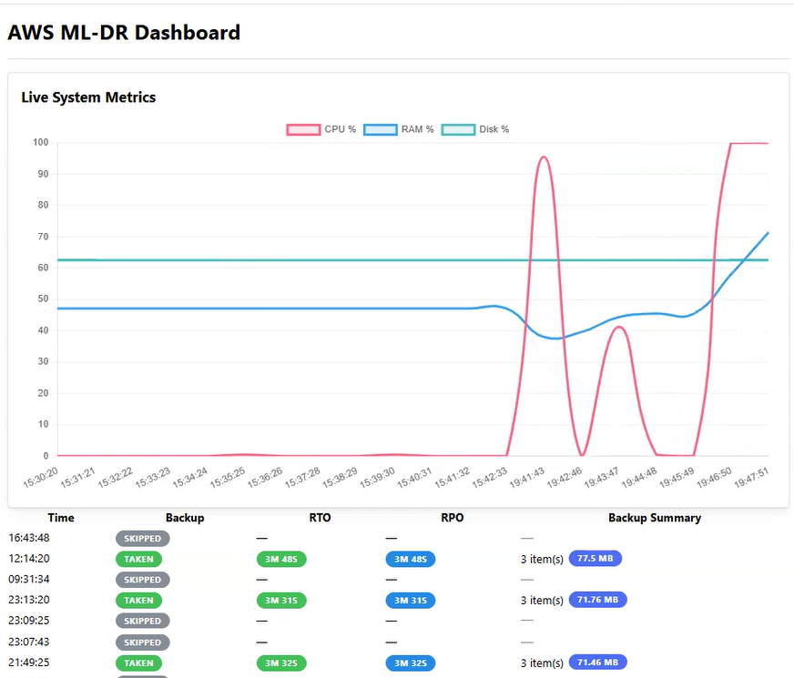
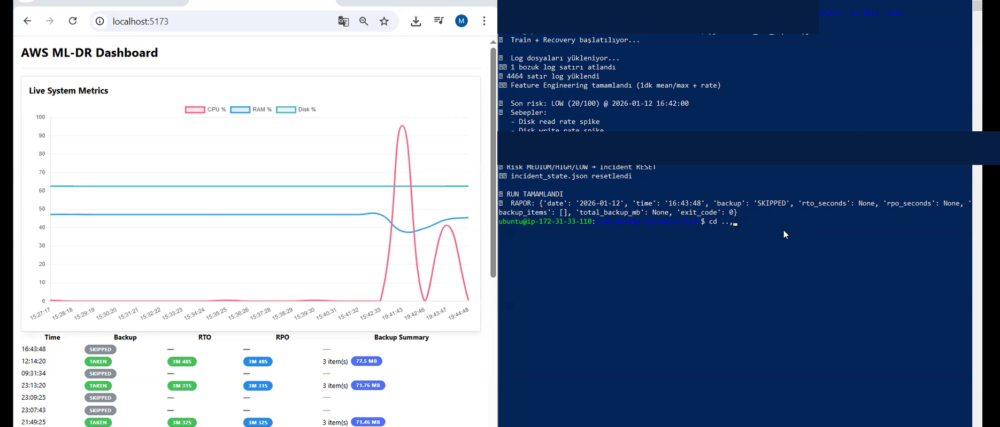
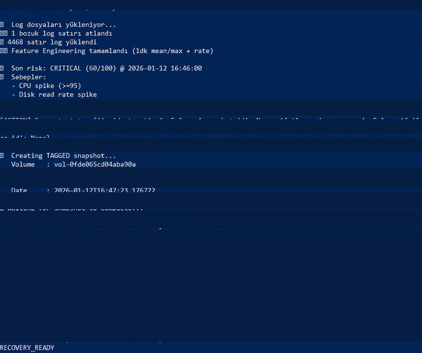
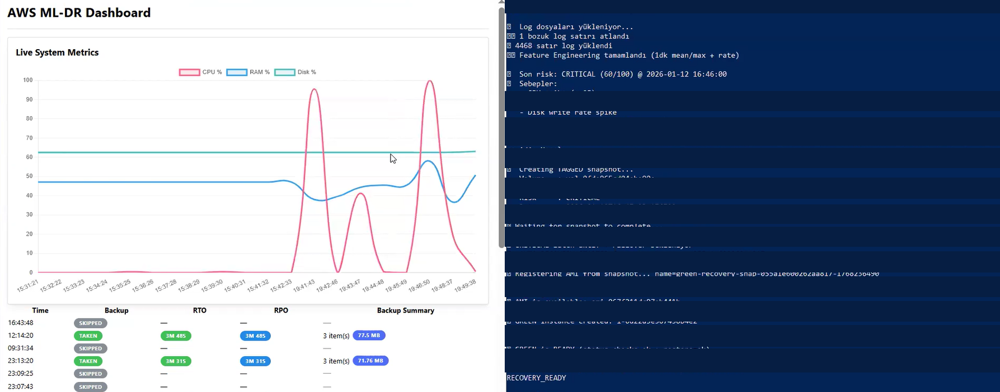
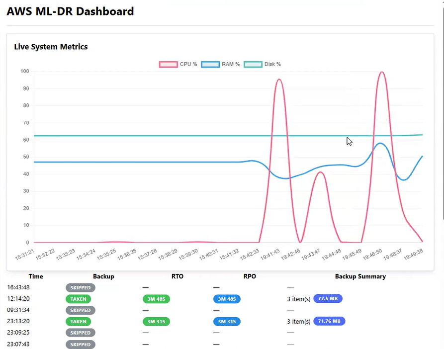

# ML Backup System
### Machine Learning-Based AWS Backup & Disaster Recovery System
### Makine Öğrenmesi Destekli AWS Yedekleme ve Felaket Kurtarma Sistemi

**Technologies:** Python · AWS EC2 · EBS Snapshots · Elastic IP · FastAPI · React · TypeScript · Isolation Forest

**Languages:** English | Türkçe

---

# 🇬🇧 English

## About the Project

ML Backup System is a machine learning-supported backup and disaster recovery project developed using Amazon Web Services (AWS).

The system monitors server performance, analyzes resource utilization, detects anomalies using the Isolation Forest algorithm, and evaluates risk levels.

When a critical risk is detected, the backend is designed to initiate an automated disaster recovery workflow using AWS EBS Snapshots, EC2 instances, and Elastic IP reassociation.

A React-based dashboard provides visibility into system metrics, anomaly detection, training history, and recovery reports.

## Key Features

- Real-time CPU, RAM, disk, and network monitoring
- Machine learning-based anomaly detection using Isolation Forest
- Automated risk classification: LOW, MEDIUM, HIGH, CRITICAL
- AWS EBS Snapshot creation
- Blue-Green EC2 disaster recovery workflow
- Elastic IP failover management
- FastAPI backend services
- React dashboard with interactive charts
- Training history and estimated RTO/RPO reporting

## System Architecture

```text
AWS EC2 Instance
       |
       v
System Metrics Monitoring
       |
       v
Machine Learning (Isolation Forest)
       |
       v
Risk Analysis
       |
       v
Critical Risk Detected?
       |
       v
AWS EBS Snapshot
       |
       v
AMI Registration
       |
       v
Green EC2 Instance
       |
       v
Readiness Verification
       |
       v
Elastic IP Failover
       |
       v
Recovery Reporting
```

## Technology Stack

| Component | Technologies |
|---|---|
| Cloud Infrastructure | AWS EC2, EBS, Elastic IP, IAM |
| Backend | Python, FastAPI |
| Machine Learning | Scikit-learn, Isolation Forest, Pandas |
| Frontend | React, TypeScript, Vite |
| Data Visualization | Chart.js, Recharts |
| System Monitoring | psutil |

## Security

AWS-specific credentials and account resource identifiers are excluded from the public repository. Example configuration files are provided for reference.

AWS-changing operations are disabled by default in the published version.

**Note:** The backend was reconstructed from the supplied project documentation. Python syntax has been checked, but end-to-end AWS recovery and application health validation have not been completed for this repository version.

---

# 🇹🇷 Türkçe

## Proje Hakkında

**ML Backup System**, Amazon Web Services (AWS) altyapısı kullanılarak geliştirilmiş, makine öğrenmesi destekli otomatik yedekleme ve felaket kurtarma projesidir.

Projenin amacı, sunucuların sistem kaynaklarını düzenli olarak izlemek, olası anormallikleri makine öğrenmesi algoritmalarıyla tespit etmek ve kritik risk durumlarında otomatik kurtarma mekanizmasını devreye almaktır.

Sistem, CPU, RAM, disk ve ağ kullanım verilerini toplar. Toplanan veriler **Isolation Forest** algoritması kullanılarak analiz edilir ve sistemin risk seviyesi belirlenir.

Kritik risk algılandığında AWS EBS Snapshot teknolojisiyle yedek alınması, bu yedekten yeni bir EC2 sunucusu oluşturulması ve Elastic IP adresinin yeni sunucuya yönlendirilmesi hedeflenmektedir.

Ayrıca React ve TypeScript kullanılarak geliştirilen web arayüzü sayesinde sistem metrikleri, anomali sonuçları, eğitim geçmişi ve kurtarma raporları görüntülenebilir.

## Projenin Özellikleri

- **Canlı sistem izleme:** CPU, RAM, disk ve ağ kullanımının takip edilmesi
- **Makine öğrenmesi:** Isolation Forest algoritmasıyla anomali tespiti
- **Risk analizi:** LOW, MEDIUM, HIGH ve CRITICAL seviyelerinin hesaplanması
- **Otomatik yedekleme:** AWS EBS Snapshot oluşturulması
- **Felaket kurtarma:** Snapshot üzerinden Green EC2 sunucusu oluşturulması
- **Blue-Green mimarisi:** Kurtarma sunucusuna geçişin yönetilmesi
- **Elastic IP yönetimi:** Trafiğin yeni sunucuya yönlendirilmesi
- **Web arayüzü:** React tabanlı dashboard
- **Raporlama:** Eğitim geçmişi ve tahmini RTO/RPO değerlerinin görüntülenmesi

## Sistemin Çalışma Mantığı

```text
AWS EC2 Sunucusu
       |
       v
CPU / RAM / Disk / Ağ İzleme
       |
       v
Isolation Forest ile Anomali Tespiti
       |
       v
Risk Seviyesi Hesaplama
       |
       v
Kritik Risk Kontrolü
       |
       v
AWS EBS Snapshot Oluşturma
       |
       v
Snapshot Üzerinden AMI Oluşturma
       |
       v
Yeni Green EC2 Sunucusu
       |
       v
Hazır Olma Kontrolü
       |
       v
Elastic IP Yönlendirme
       |
       v
Kurtarma Raporu
```

## Kullanılan Teknolojiler

| Alan | Teknolojiler |
|---|---|
| Bulut Bilişim | AWS EC2, EBS, Elastic IP, IAM |
| Backend | Python, FastAPI |
| Makine Öğrenmesi | Scikit-learn, Isolation Forest |
| Veri İşleme | Pandas, NumPy |
| Frontend | React, TypeScript, Vite |
| Grafikler | Chart.js, Recharts |
| Sistem İzleme | psutil |

## Kurulum

Backend:

```bash
python3 -m venv .venv
source .venv/bin/activate
pip install -r requirements.txt
uvicorn api.main:app --host 127.0.0.1 --port 8000
```

Frontend:

```bash
cd frontend
npm ci
npm run dev
```

Arayüz: http://localhost:5173

Sistem metriklerini toplamak için:

```bash
python scripts/monitor.py
```

## Güvenlik ve Önemli Notlar

- Gerçek AWS erişim anahtarları ve hesap yapılandırmaları GitHub'da paylaşılmamaktadır.
- AWS kaynak kimlikleri örnek yapılandırma dosyalarıyla temsil edilmektedir.
- AWS üzerinde değişiklik yapan API işlemleri varsayılan olarak devre dışıdır.
- Gerçek AWS ortamında çalıştırmadan önce IAM yetkileri ve uygulama erişim güvenliği yapılandırılmalıdır.
- Bu sürümde uçtan uca AWS kurtarma testi doğrulanmamıştır.
- RTO/RPO değerleri ölçüm yaklaşımına dayalı tahminlerdir; garanti edilen kurtarma süreleri değildir.

---

## Project Purpose / Projenin Amacı

**EN:** To explore how machine learning and cloud infrastructure automation can be combined to build a proactive backup and disaster recovery solution.

**TR:** Makine öğrenmesi ve bulut altyapısı otomasyonunu bir araya getirerek sistem anormalliklerini tespit eden ve kritik durumlarda otomatik kurtarma süreçlerini başlatabilen bir çözüm geliştirmek.

---

**Project Category:** Cloud Computing · Machine Learning · Disaster Recovery · AWS Automation


### 📸 Screenshots / Ekran Görüntüleri

### 1. Main Dashboard


### 2. Dashboard and Terminal Monitoring


### 3. AWS Recovery Terminal


### 4. Dashboard and AWS Recovery


### 5. Recovery View
